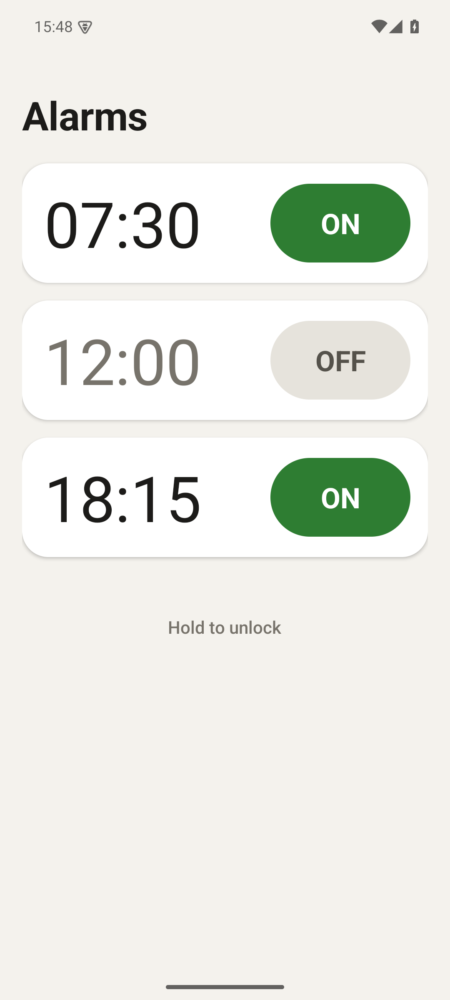
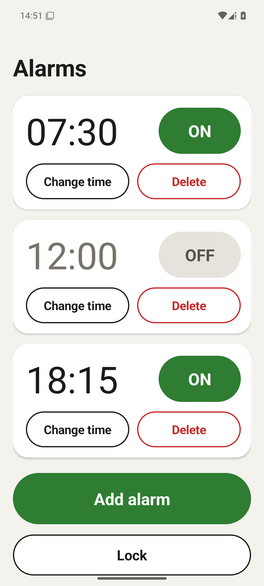

# SeniorAlert

A very simple alarm app for Android, made for seniors.

Someone who helps (a family member, a carer) sets up the alarms once and locks
the app. After that the only thing anyone can do is switch an alarm ON or OFF.
When an alarm rings, the screen shows one huge **Turn off** button, nothing
else.

English and German. The app follows the phone's language.

[Deutsch weiter unten](#senioralert-deutsch)

## What it does

- **Several alarms.** Each one is just a time and a big ON/OFF button.
- **Rings once.** An alarm that is ON rings once, at its next time, then
  switches itself OFF. To make it ring again, switch it ON again.
- **Lock with a PIN.** When locked, alarms can only be switched ON and OFF.
  Adding, changing or deleting needs the PIN.
- **One button to stop.** No snooze, no swiping, no small buttons.
- **Stops by itself after 2 minutes**, even if nobody presses anything.

That is all it does, on purpose. No other screens, no settings, no account, no
internet, no ads.

## What you see

  
  
  

**Main screen.** A list of alarm times. Next to each time, a big green **ON**
or grey **OFF** button. Unlocked, each alarm also has **Change time** and
**Delete**, and at the bottom there are **Add alarm** and **Lock**. Locked,
only the times and the ON/OFF buttons are left, plus a small **Hold to unlock**
at the very bottom. It only reacts when held down, so it cannot be opened by a
stray tap. The PIN prompt closes by itself if nothing is typed for 10 seconds.

**When an alarm rings.** The phone wakes up, even when it is locked, and shows
the current time and one huge red **Turn off** button.

## It can always be switched off

A ringing alarm can never get stuck, locked or not. Any of these stops it, and
none of them asks for the PIN:

- the big **Turn off** button,
- the phone's volume buttons,
- **Turn off** in the notification,
- the red **Turn off** bar at the top of the app,
- and after 2 minutes it stops by itself.

## Install

1. Download the latest `SeniorAlert-*.apk` from the
   [Releases](https://github.com/philipphueber/SeniorAlert/releases) page on the
   phone.
2. Open it. Android asks whether to allow installing from this source; allow it
   once.

Needs Android 8.0 or newer.

## Setting it up (for the helper)

Do this once, while the app is unlocked. The app shows a yellow box for
anything that still needs to be allowed. Tap each box and allow it:

- **Notifications.** Without them the alarm screen cannot appear.
- **Full-screen alarms** (newer Android versions). Lets the alarm screen show
  over the lock screen.
- **Alarms & reminders** (Android 12). Without it alarms may ring late.
- **Battery.** Let the app run without restrictions, so the phone does not stop
  the alarms.

Then:

1. Add the alarms and check that they show **ON**.
2. Test it: add an alarm for one or two minutes from now and wait for it.
3. Make sure the phone's alarm volume is up.
4. Tap **Lock** and choose a PIN (4 to 8 digits). Write the PIN down somewhere
   safe.

## Forgotten PIN

There is no way to recover it. Clear the app's data: Settings, Apps,
SeniorAlert, Storage, Clear data. This removes the PIN **and all alarms**.
Then set everything up again.

## Privacy

The app has no internet access at all (it does not even ask for it), no
account, no tracking and no ads. Alarms are stored only on the phone.

## Contributing and licence

Building, technical details and how to help: [CONTRIBUTING.md](CONTRIBUTING.md)
and [ARCHITECTURE.md](ARCHITECTURE.md). Licensed under the
[Apache License 2.0](LICENSE).

---

# SeniorAlert (Deutsch)

Ein ganz einfacher Wecker für Android, gemacht für Senioren.

Eine helfende Person (Familie, Pflege) richtet die Wecker einmal ein und sperrt
die App. Danach kann man nur noch Wecker AN- oder AUSschalten. Wenn ein Wecker
klingelt, zeigt der Bildschirm einen riesigen Knopf **Ausschalten**, sonst
nichts.

Deutsch und Englisch. Die App folgt der Sprache des Telefons.

## Was die App kann

- **Mehrere Wecker.** Jeder ist nur eine Uhrzeit und ein großer AN/AUS-Knopf.
- **Klingelt einmal.** Ein eingeschalteter Wecker klingelt einmal zur nächsten
  passenden Uhrzeit und schaltet sich dann selbst AUS. Damit er wieder
  klingelt, schaltet man ihn wieder AN.
- **Sperre mit PIN.** Gesperrt kann man Wecker nur AN- und AUSschalten.
  Hinzufügen, Ändern und Löschen brauchen die PIN.
- **Ein Knopf zum Ausschalten.** Kein Schlummern, kein Wischen, keine kleinen
  Knöpfe.
- **Hört nach 2 Minuten von selbst auf**, auch wenn niemand etwas drückt.

Mehr kann die App absichtlich nicht. Keine weiteren Seiten, keine
Einstellungen, kein Konto, kein Internet, keine Werbung.

## Was man sieht

Bilder siehe [oben](#what-you-see) (englische Ansicht; auf einem deutschen
Telefon steht dort AN, AUS, Ausschalten).

**Hauptseite.** Eine Liste mit Weckzeiten. Neben jeder Zeit ein großer grüner
Knopf **AN** oder grauer Knopf **AUS**. Entsperrt hat jeder Wecker zusätzlich
**Zeit ändern** und **Löschen**, unten stehen **Wecker hinzufügen** und
**Sperren**. Gesperrt bleiben nur die Zeiten und die AN/AUS-Knöpfe, ganz unten
ein kleines **Zum Entsperren gedrückt halten**. Es reagiert nur, wenn man es
gedrückt hält, also nicht auf versehentliches Antippen. Die PIN-Abfrage
schließt sich von selbst, wenn 10 Sekunden lang nichts eingegeben wird.

**Wenn ein Wecker klingelt.** Das Telefon wacht auf, auch wenn es gesperrt
ist, und zeigt die Uhrzeit und einen riesigen roten Knopf **Ausschalten**.

## Ausschalten geht immer

Ein klingelnder Wecker kann nie hängen bleiben, gesperrt oder nicht. Jedes
davon schaltet ihn aus, und nichts davon fragt nach der PIN:

- der große Knopf **Ausschalten**,
- die Lautstärketasten des Telefons,
- **Ausschalten** in der Benachrichtigung,
- der rote Balken **Ausschalten** oben in der App,
- und nach 2 Minuten hört er von selbst auf.

## Installieren

1. Die neueste `SeniorAlert-*.apk` auf dem Telefon von der Seite
   [Releases](https://github.com/philipphueber/SeniorAlert/releases)
   herunterladen.
2. Öffnen. Android fragt, ob Installationen aus dieser Quelle erlaubt sind;
   einmal erlauben.

Braucht Android 8.0 oder neuer.

## Einrichten (für die helfende Person)

Einmal erledigen, solange die App entsperrt ist. Die App zeigt einen gelben
Kasten für alles, was noch erlaubt werden muss. Jeden Kasten antippen und
erlauben:

- **Benachrichtigungen.** Ohne sie kann der Wecker-Bildschirm nicht
  erscheinen.
- **Vollbild-Wecker** (neuere Android-Versionen). Damit erscheint der Wecker
  über dem Sperrbildschirm.
- **Wecker und Erinnerungen** (Android 12). Ohne das klingeln Wecker eventuell
  zu spät.
- **Akku.** Die App ohne Einschränkungen laufen lassen, damit das Telefon die
  Wecker nicht stoppt.

Danach:

1. Die Wecker anlegen und prüfen, dass sie **AN** zeigen.
2. Testen: einen Wecker für in ein, zwei Minuten anlegen und abwarten.
3. Prüfen, dass die Wecker-Lautstärke des Telefons hoch ist.
4. **Sperren** antippen und eine PIN wählen (4 bis 8 Ziffern). Die PIN an
   einem sicheren Ort notieren.

## PIN vergessen

Sie lässt sich nicht wiederherstellen. App-Daten löschen: Einstellungen, Apps,
SeniorAlert, Speicher, Daten löschen. Damit sind die PIN **und alle Wecker**
weg. Danach alles neu einrichten.

## Datenschutz

Die App hat keinerlei Internetzugang (sie fragt nicht einmal danach), kein
Konto, kein Tracking und keine Werbung. Die Wecker werden nur auf dem Telefon
gespeichert.
